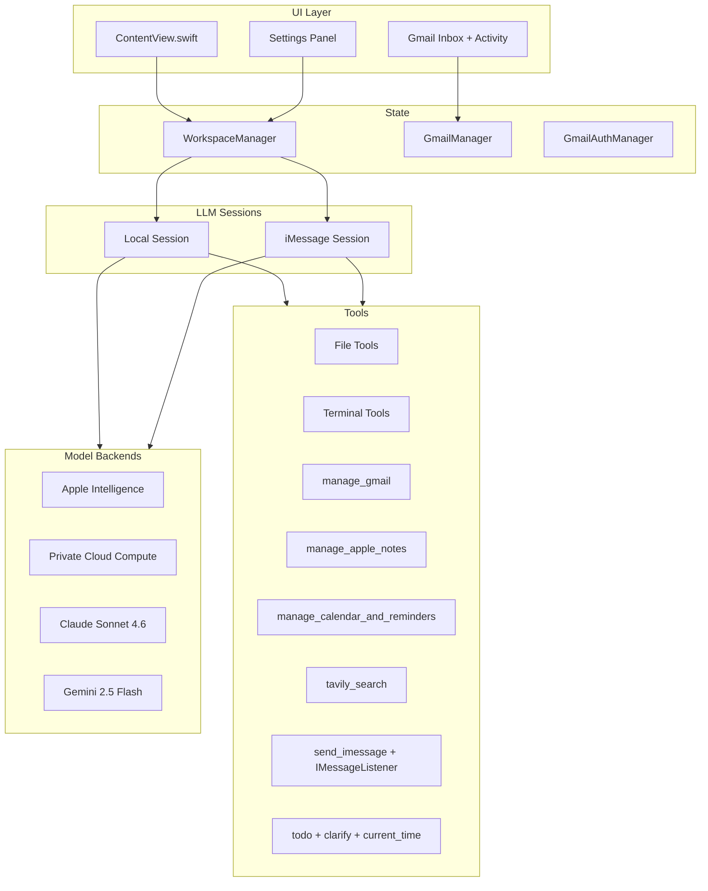

# Zoro on Linear — Complete Setup Guide

This document is the source of truth for tracking Zoro in Linear. It inventories every shipped capability, documents known gaps, and provides copy-paste-ready issue templates.

**Related docs:** [`.agents/AGENTS.md`](../.agents/AGENTS.md) · [`reference/gmail-setup.md`](gmail-setup.md) · [`NOTES.md`](../NOTES.md)

---

## What Zoro Is

Zoro is a **native macOS SwiftUI app** (`uditagarwal.zoro`) that acts as an AI personal assistant with tool-calling. You select a workspace folder, pick an LLM backend, and chat with an agent that can:

- Read, write, search, and patch files in the workspace
- Run shell commands (foreground and background)
- Search the web and save research to Apple Notes
- Manage Calendar events and Reminders
- Read and act on Gmail (first-class integration with anti-hallucination guardrails)
- Send and receive iMessage commands remotely

**Platform:** macOS 27.0+, Xcode 26.x+ on Apple Silicon. Builds only on macOS — not on Linux/cloud agents.



---

## Linear Project Structure

### Project

| Field | Value |
|---|---|
| **Name** | Zoro |
| **Description** | macOS AI assistant with tool-calling and deep Apple integrations (Gmail, Notes, Calendar, iMessage) |
| **Repo** | This workspace / GitHub remote |
| **Key doc** | `.agents/AGENTS.md` |

### Milestones

| Milestone | Purpose |
|---|---|
| **v0 — Shipped** | Baseline inventory of everything that exists today (mark Done) |
| **v1 — Gmail Hardening** | OCR, OAuth verification, expanded tests |
| **v2 — Real-Time Sync** | Gmail Pub/Sub push notifications |
| **v3 — Quality & DX** | Test coverage, dead code cleanup, developer experience |
| **Learning (optional)** | Teaching lessons from `NOTES.md` |

### Labels

**Area labels** (one per issue):

| Label | Scope |
|---|---|
| `area:core` | Chat UI, sessions, settings, workspace selection |
| `area:llm` | Model backends, availability, API keys |
| `area:files` | File read/write/list/search/patch |
| `area:terminal` | Shell commands, background processes |
| `area:calendar` | EventKit events and reminders |
| `area:notes` | Apple Notes integration |
| `area:gmail` | Gmail OAuth, REST client, tool, UI, auditor |
| `area:imessage` | Listener, remote commands, outbound messages |
| `area:security` | SecurityPolicy, Keychain, permissions, rate limits |
| `area:testing` | Unit/integration tests |
| `area:docs` | AGENTS.md, lessons, setup guides |

**Type labels:**

| Label | Use for |
|---|---|
| `type:feature` | New user-facing capability |
| `type:bug` | Defect |
| `type:chore` | Refactor, cleanup, deps |
| `type:verification` | Manual macOS verification task |
| `type:docs` | Documentation only |

**Status labels** (optional, if not using Done/Todo states):

| Label | Use for |
|---|---|
| `status:shipped` | Existing feature in baseline inventory |

### Saved Views

| View name | Filter |
|---|---|
| **Roadmap** | Open issues, `type:feature`, grouped by `area:*` |
| **Shipped Inventory** | Milestone = v0 Shipped, or `status:shipped` |
| **Gmail Focus** | `area:gmail` |
| **iMessage Focus** | `area:imessage` |
| **Needs macOS Verification** | `type:verification`, not Done |
| **Backlog** | Open issues, milestone ≠ v0 Shipped |

---

## Execution Context: Local vs iMessage Remote

Zoro runs two distinct agent sessions with different tool permissions.

### Tool availability matrix

| Tool | Local UI | iMessage Remote |
|---|---|---|
| `list_directory` | Yes | Yes |
| `read_file` | Yes | Yes |
| `write_file` | Yes | **No** |
| `patch` | Yes | **No** |
| `search_files` | Yes | Yes |
| `run_terminal_command` | Yes | **No** |
| `get_process_status` | Yes | **No** |
| `current_time` | Yes | Yes |
| `clarify` | Yes | **No** |
| `todo` | Yes | Yes |
| `manage_calendar_and_reminders` | All actions | All except `delete_event` |
| `manage_apple_notes` | All actions | Read/list/search only (no create/append) |
| `tavily_search` | Yes | Yes |
| `send_imessage` | Any recipient | **Requester only** |
| `manage_gmail` | All actions | Read/search only (no send/trash/draft/reply) |

Source: [`zoro/SecurityPolicy.swift`](../zoro/SecurityPolicy.swift), [`zoro/WorkspaceManager.swift`](../zoro/WorkspaceManager.swift)

### iMessage remote command format

```
zoro: <passcode> <your command here>
```

Example: `zoro: mysecret summarize my unread emails`

---

## Security Limits Reference

| Limit | Value | Source |
|---|---|---|
| Max file read size | 2 MB | `SecurityPolicy.maxFileReadBytes` |
| Max shell output | 512 KB | `SecurityPolicy.maxShellOutputBytes` |
| Shell timeout | 120 seconds | `SecurityPolicy.shellTimeoutSeconds` |
| Max iMessage attachment read | 1 MB | `SecurityPolicy.maxIMessageAttachmentBytes` |
| iMessage rate limit | 5 commands/min/sender | `SecurityPolicy.iMessageRateLimitPerMinute` |
| Max iMessage reply length | 4,000 chars | `SecurityPolicy.maxIMessageReplyCharacters` |
| Gmail page size | 25 | `SecurityPolicy.gmailPageSize` |
| Max Gmail messages per operation | 250 | `SecurityPolicy.maxGmailMessagesPerOperation` |
| Max Gmail batch read | 20 | `SecurityPolicy.maxGmailBatchRead` |
| Max Gmail body bytes | 1 MB | `SecurityPolicy.maxGmailBodyBytes` |
| Max Gmail attachment bytes | 512 KB | `SecurityPolicy.maxGmailAttachmentBytes` |
| Gmail API retries | 5 (429/5xx backoff) | `SecurityPolicy.gmailMaxRetries` |
| Gmail auto-refresh interval | 5 minutes | `SecurityPolicy.gmailAutoRefreshSeconds` |

---

## Complete Feature Catalog (Shipped)

Use these as **Done** issues under milestone **v0 — Shipped**.

---

### Epic: Core App & Chat UI

| ID | Title | Description | Code |
|---|---|---|---|
| ZORO-001 | Chat UI with streaming responses | Message bubbles for user/assistant; assistant streams tokens in real time via `streamResponse(to:)` | `ContentView.swift` |
| ZORO-002 | Workspace folder selection | User picks a workspace directory via `NSOpenPanel`; all file tools scoped to this path | `ContentView.swift`, `WorkspaceManager.swift` |
| ZORO-003 | Settings panel | Gear icon toggles settings drawer: model config, API keys, Gmail, iMessage | `ContentView.swift` |
| ZORO-004 | Session reset on config change | Changing workspace, model, or integration config invalidates LLM sessions | `WorkspaceManager.resetSession()`, `invalidateSessionsForConfigChange()` |
| ZORO-005 | Conversation context compression | When context limit exceeded, conversation is summarized and session restarted | `WorkspaceManager.swift` |
| ZORO-006 | Execution Plan UI | Agent `todo` tool updates visible checklist with pending/in_progress/completed states | `TodoTool.swift`, `ContentView.swift` |
| ZORO-007 | Research Progress UI | Web search and note-creation steps shown with in-progress/completed/failed states | `TavilySearchTool.swift`, `AppleNotesTool.swift`, `ContentView.swift` |
| ZORO-008 | Clarify tool (local only) | Agent can suspend and ask user a question mid-task; UI shows question and waits for reply | `ClarifyTool.swift` |
| ZORO-009 | Keychain secret storage | Anthropic, Gemini, Tavily, Gmail OAuth, iMessage passcode stored in macOS Keychain | `KeychainHelper.swift` |
| ZORO-010 | Model availability diagnostics | Settings panel shows ready/warning state with actionable tips per backend | `ContentView.updateModelAvailability()` |

**Labels:** `area:core`, `status:shipped` · **Milestone:** v0 Shipped

---

### Epic: LLM Backends

| ID | Title | Description | Code |
|---|---|---|---|
| ZORO-011 | On-Device Apple Intelligence | Default backend via `SystemLanguageModel.default`; requires Apple Intelligence enabled | `WorkspaceManager.makeSession()` |
| ZORO-012 | Private Cloud Compute | Optional backend; requires `com.apple.developer.private-cloud-compute` entitlement | `WorkspaceManager.swift` |
| ZORO-013 | Claude Sonnet 4.6 | Anthropic API via `ClaudeForFoundationModels` SPM; API key in settings | `ClaudeForFoundationModels`, `ContentView.swift` |
| ZORO-014 | Gemini 2.5 Flash | Custom `GeminiLanguageModel` adapter; API key sent via `x-goog-api-key` header | `GeminiLanguageModel.swift` |
| ZORO-015 | Model type persistence | Selected model saved to `UserDefaults` key `selected_model_type` | `ContentView.swift` |
| ZORO-016 | Separate local and iMessage sessions | `getOrCreateSession(context:)` creates isolated sessions with different tools/instructions | `WorkspaceManager.swift` |

**Labels:** `area:llm`, `status:shipped` · **Milestone:** v0 Shipped

---

### Epic: Workspace & File Tools

| ID | Title | Description | Code |
|---|---|---|---|
| ZORO-020 | `list_directory` tool | List files/folders at relative path with type and size | `FileTools.swift` |
| ZORO-021 | `read_file` tool | Read UTF-8 text files up to 2 MB | `FileTools.swift` |
| ZORO-022 | `write_file` tool | Create or overwrite files in workspace | `FileTools.swift` |
| ZORO-023 | `patch` tool | Find/replace unique contiguous block; preferred for code edits | `PatchTool.swift` |
| ZORO-024 | `search_files` tool | ripgrep search with Swift file enumerator fallback | `SearchFilesTool.swift` |
| ZORO-025 | Workspace path scoping | Reject absolute paths, `~`, and directory traversal outside workspace root | `SecurityPolicy.resolveWorkspacePath()` |

**Labels:** `area:files`, `status:shipped` · **Milestone:** v0 Shipped

---

### Epic: Terminal & Background Processes

| ID | Title | Description | Code |
|---|---|---|---|
| ZORO-030 | `run_terminal_command` (foreground) | Execute zsh command in workspace; 120s timeout, 512 KB output cap | `CommandLineTool.swift`, `WorkspaceManager.runCommand()` |
| ZORO-031 | `run_terminal_command` (background) | `runInBackground: true` returns task ID immediately; process tracked in `activeProcesses` | `CommandLineTool.swift`, `WorkspaceManager.runCommandBackground()` |
| ZORO-032 | `get_process_status` tool | Monitor background task logs, exit status, and output | `ProcessStatusTool.swift` |
| ZORO-033 | Process pruning | Terminated background processes cleaned up on session reset | `WorkspaceManager.pruneTerminatedProcesses()` |

**Labels:** `area:terminal`, `status:shipped` · **Milestone:** v0 Shipped

---

### Epic: Calendar & Reminders

Tool: `manage_calendar_and_reminders` · [`EventKitTool.swift`](../zoro/EventKitTool.swift)

| ID | Title | Action | Description |
|---|---|---|---|
| ZORO-040 | Create calendar event | `create_event` | Title, start/end ISO8601 dates, optional location/notes |
| ZORO-041 | List calendar events | `list_events` | Query events in date range |
| ZORO-042 | Delete calendar event | `delete_event` | Delete by event ID (blocked in iMessage remote) |
| ZORO-043 | Create reminder | `create_reminder` | Title, optional due date, optional notes |
| ZORO-044 | List reminders | `list_reminders` | List incomplete reminders |
| ZORO-045 | Complete reminder | `complete_reminder` | Mark reminder done by ID |

**Labels:** `area:calendar`, `status:shipped` · **Milestone:** v0 Shipped

---

### Epic: Apple Notes

Tool: `manage_apple_notes` · [`AppleNotesTool.swift`](../zoro/AppleNotesTool.swift)

| ID | Title | Action | Description |
|---|---|---|---|
| ZORO-050 | Create note | `create_note` | Markdown body converted to HTML; synced via Notes.app |
| ZORO-051 | List notes | `list_notes` | Returns note IDs and titles |
| ZORO-052 | Search notes | `search_notes` | Search by query string |
| ZORO-053 | Read note | `read_note` | Read full note body by ID |
| ZORO-054 | Append to note | `append_note` | Append content to existing note |

**Labels:** `area:notes`, `status:shipped` · **Milestone:** v0 Shipped

---

### Epic: Web Search (Tavily)

Tool: `tavily_search` · [`TavilySearchTool.swift`](../zoro/TavilySearchTool.swift)

| ID | Title | Description |
|---|---|---|
| ZORO-060 | Basic web search | `searchDepth: "basic"` — quick results with synthesized answer |
| ZORO-061 | Advanced deep research | `searchDepth: "advanced"` — deeper research runs |
| ZORO-062 | Configurable result count | `maxResults` parameter (default 5) |
| ZORO-063 | Research step tracking | Each search adds a Research Progress UI step |

**Labels:** `area:core`, `status:shipped` · **Milestone:** v0 Shipped

---

### Epic: Gmail Integration (First-Class)

Tool: `manage_gmail` · See [`reference/gmail-setup.md`](gmail-setup.md)

#### OAuth & Connection

| ID | Title | Description | Code |
|---|---|---|---|
| ZORO-070 | Gmail OAuth 2.0 desktop flow | Client ID/secret in settings; browser auth; callback on `http://127.0.0.1:8765/` | `GmailAuthManager.swift` |
| ZORO-071 | Gmail token storage in Keychain | Access/refresh tokens persisted securely | `GmailAuthManager.swift`, `KeychainHelper.swift` |
| ZORO-072 | Connect/Disconnect Gmail UI | Settings panel buttons; status message | `ContentView.swift` |
| ZORO-073 | Gmail header badge | Shows connected email, unread count, last sync, manual refresh | `ContentView.swift`, `GmailManager.swift` |
| ZORO-074 | Gmail inbox preview panel | Latest inbox messages when connected | `ContentView.swift` |
| ZORO-075 | Gmail activity log | In-progress/completed/failed fetch steps during agent runs | `GmailManager.logActivity()` |
| ZORO-076 | Gmail auto-refresh | Snapshot refresh every 5 minutes when connected | `GmailManager.startAutoRefreshIfNeeded()` |

#### Read & Index Actions

| ID | Title | Action | Description |
|---|---|---|---|
| ZORO-080 | Gmail status | `get_status` | Account email, unread inbox count, totals |
| ZORO-081 | List messages (index) | `list_messages` | Metadata + snippets only; `fetchAll` up to 250 |
| ZORO-082 | Search messages (index) | `search_messages` | Gmail query syntax; index only |
| ZORO-083 | Read single message | `read_message` | Full body with `body_complete` flag |
| ZORO-084 | Read message batch | `read_messages` | Up to 20 messages per batch |
| ZORO-085 | Read thread | `read_thread` | All messages in thread with full bodies |
| ZORO-086 | Read attachment | `read_attachment` | Text, JSON, XML, CSV, PDF (via PDFKit) |

#### Write & Label Actions

| ID | Title | Action | Description |
|---|---|---|---|
| ZORO-090 | Mark as read | `mark_read` | Remove UNREAD label |
| ZORO-091 | Archive message | `archive_message` | Remove from INBOX |
| ZORO-092 | Star message | `star_message` | Add STARRED label |
| ZORO-093 | Unstar message | `unstar_message` | Remove STARRED label |
| ZORO-094 | Modify labels | `modify_labels` | Add/remove custom labels |
| ZORO-095 | List labels | `list_labels` | All Gmail labels |
| ZORO-096 | Create draft | `create_draft` | Draft with to/subject/body |
| ZORO-097 | Reply to thread | `reply_to_thread` | Threaded reply with In-Reply-To headers |
| ZORO-098 | Send email | `send_email` | Send new email |
| ZORO-099 | Trash message | `trash_message` | Move to trash |

#### Anti-Hallucination & Safety

| ID | Title | Description | Code |
|---|---|---|---|
| ZORO-100 | Gmail fetch reports | Every response includes `=== GMAIL FETCH REPORT ===` with `fetch_complete`, counts, warnings | `GmailService.swift` |
| ZORO-101 | Index vs read separation | Search/list marked INDEX ONLY; agent must call read_* before summarizing | `GmailTool.swift`, agent instructions |
| ZORO-102 | GmailReadAuditor | Blocks assistant responses that summarize without full read in same turn | `GmailReadAuditor.swift` |
| ZORO-103 | Session read tracking | Tracks message IDs fully read; appended to tool responses | `GmailManager.sessionReadFooter()` |
| ZORO-104 | Dynamic Gmail instructions | When connected, mandatory Gmail rules injected into session instructions | `GmailManager.contextualInstructions()` |
| ZORO-105 | iMessage Gmail restrictions | Remote sessions: read/search only; send/trash/draft/reply blocked | `SecurityPolicy.isGmailActionPermitted()` |

**Labels:** `area:gmail`, `status:shipped` · **Milestone:** v0 Shipped

---

### Epic: iMessage Integration

| ID | Title | Description | Code |
|---|---|---|---|
| ZORO-110 | Outbound iMessage | `send_imessage` via Messages.app AppleScript; imessage/sms/auto service | `IMessageTool.swift` |
| ZORO-111 | Inbound command listener | Watches `~/Library/Messages/chat.db` with GCD file watcher + 10s fallback poll | `IMessageListener.swift` |
| ZORO-112 | Remote command parsing | Commands prefixed `zoro:` with passcode validation | `IMessageListener.processIncomingMessage()` |
| ZORO-113 | Sender whitelist | Comma-separated phone/email whitelist in settings | `ContentView.swift`, `SecurityPolicy.isSenderWhitelisted()` |
| ZORO-114 | Passcode requirement | Passcode in Keychain; listener disabled without it | `ContentView.swift`, `KeychainHelper.swift` |
| ZORO-115 | Rate limiting | 5 commands per minute per sender | `IMessageListener.isRateLimited()` |
| ZORO-116 | Incoming-only filter | Only processes `is_from_me = 0` to prevent self-trigger loops | `IMessageListener.swift` |
| ZORO-117 | Attachment injection | Text attachments from Messages folder appended to remote prompt | `IMessageListener.processIncomingMessage()` |
| ZORO-118 | Reply truncation | Replies capped at 4,000 characters | `IMessageListener.truncateReply()` |
| ZORO-119 | Full Disk Access diagnostic | UI warning when FDA not granted for chat.db access | `ContentView.swift` |
| ZORO-120 | Restricted remote tool set | Separate session with reduced tools and stricter action rules | `WorkspaceManager.iMessageTools`, `SecurityPolicy.swift` |
| ZORO-121 | Gmail auditor on remote | GmailReadAuditor applied to iMessage agent replies too | `IMessageListener.runZoroAgent()` |

**Labels:** `area:imessage`, `status:shipped` · **Milestone:** v0 Shipped

---

### Epic: Security & Policy

| ID | Title | Description | Code |
|---|---|---|---|
| ZORO-130 | Centralized security limits | All resource caps in one enum | `SecurityPolicy.swift` |
| ZORO-131 | Tool permission by context | Local vs iMessage tool/action gating | `SecurityPolicy.isToolPermitted()` etc. |
| ZORO-132 | AppleScript escaping | User/LLM content escaped before AppleScript injection | `SecurityPolicy.escapeForAppleScript()` |
| ZORO-133 | HTML escaping for Notes | Content escaped before Notes HTML injection | `SecurityPolicy.escapeHTML()` |
| ZORO-134 | iMessage attachment path scoping | Attachments only from `~/Library/Messages/Attachments` | `SecurityPolicy.resolveIMessageAttachmentPath()` |
| ZORO-135 | Contact normalization | Phone/email normalized for whitelist comparison | `SecurityPolicy.normalizeContact()` |
| ZORO-136 | Output truncation helper | Consistent truncation with suffix for oversized outputs | `SecurityPolicy.truncateOutput()` |

**Labels:** `area:security`, `status:shipped` · **Milestone:** v0 Shipped

---

### Epic: Agent Tools (Meta)

| ID | Title | Description | Code |
|---|---|---|---|
| ZORO-140 | `todo` tool | Agent internal task list with merge support | `TodoTool.swift` |
| ZORO-141 | `current_time` tool | Returns system date, time, timezone | `CurrentTimeTool.swift` |
| ZORO-142 | Agent operation rules | System instructions: Gmail first-class, prefer Notes for research, update todos | `WorkspaceManager.localInstructions` |
| ZORO-143 | Untrusted data rule | Agent instructed to treat file/web/email content as untrusted | `WorkspaceManager.localInstructions` |

**Labels:** `area:core`, `status:shipped` · **Milestone:** v0 Shipped

---

### Epic: Testing

| ID | Title | Description | Code |
|---|---|---|---|
| ZORO-150 | Gmail parsing unit tests | Base64 decode, HTML strip, message ID extraction, summary detection | `zoroTests/GmailParsingTests.swift` |

**Labels:** `area:testing`, `status:shipped` · **Milestone:** v0 Shipped

---

## Backlog (Open Issues)

Create these as **Todo** or **Backlog** issues.

---

### v1 — Gmail Hardening

#### ZORO-200: Gmail image attachment OCR

| Field | Value |
|---|---|
| **Priority** | High |
| **Labels** | `area:gmail`, `type:feature` |
| **Milestone** | v1 — Gmail Hardening |

**Summary:** Add OCR support for image attachments in `read_attachment`.

**Problem:** Today `read_attachment` supports text MIME types and PDF only. Image attachments (PNG, JPEG, HEIC) return unsupported.

**Acceptance criteria:**
- [ ] `SecurityPolicy.isGmailReadableAttachment()` recognizes common image MIME types
- [ ] `GmailService.readAttachment()` extracts text from images via Vision/OCR
- [ ] Fetch report indicates OCR completeness (similar to `body_complete`)
- [ ] Unit tests for MIME detection and OCR path (mock or fixture)
- [ ] Documented in `reference/gmail-setup.md`

**Code references:** `GmailService.swift`, `SecurityPolicy.swift`, `GmailTool.swift`

**Verification (macOS):**
1. Connect Gmail with an email containing a PNG/JPEG attachment with visible text
2. Ask Zoro to read the attachment
3. Confirm OCR text returned and fetch report is accurate

---

#### ZORO-201: Gmail OAuth macOS verification

| Field | Value |
|---|---|
| **Priority** | High |
| **Labels** | `area:gmail`, `type:verification` |
| **Milestone** | v1 — Gmail Hardening |

**Summary:** End-to-end verification of Gmail OAuth on macOS.

**Acceptance criteria:**
- [ ] Fresh Connect Gmail flow succeeds with test Google Cloud credentials
- [ ] Token refresh works after access token expiry
- [ ] Disconnect clears tokens and UI state
- [ ] Agent can get_status, list, search, read, and send (if desired)

**Code references:** `GmailAuthManager.swift`, `reference/gmail-setup.md`

---

#### ZORO-202: Expand Gmail test coverage

| Field | Value |
|---|---|
| **Priority** | Medium |
| **Labels** | `area:gmail`, `area:testing`, `type:feature` |
| **Milestone** | v1 — Gmail Hardening |

**Summary:** Add unit tests beyond parsing — fetch report formatting, auditor logic, action permission matrix.

**Acceptance criteria:**
- [ ] Tests for `GmailReadAuditor.auditAssistantResponse()` edge cases
- [ ] Tests for `SecurityPolicy.isGmailActionPermitted()` local vs iMessage
- [ ] Tests for fetch report `fetch_complete` flag logic
- [ ] All tests pass via ⌘U in Xcode

**Code references:** `GmailReadAuditor.swift`, `GmailParsing.swift`, `SecurityPolicy.swift`

---

### v2 — Real-Time Sync

#### ZORO-210: Gmail Pub/Sub push notifications

| Field | Value |
|---|---|
| **Priority** | Medium |
| **Labels** | `area:gmail`, `type:feature` |
| **Milestone** | v2 — Real-Time Sync |

**Summary:** Replace polling-only inbox sync with Gmail Pub/Sub push notifications.

**Problem:** Today inbox updates via on-demand fetch + 5-minute auto-refresh. No real-time push.

**Acceptance criteria:**
- [ ] Design doc for Pub/Sub topic, subscription, and HTTPS webhook endpoint
- [ ] New mail triggers snapshot refresh without manual action
- [ ] Graceful fallback to periodic refresh if push unavailable
- [ ] Document setup requirements (public HTTPS endpoint)

**Code references:** `GmailManager.swift`, `GmailService.swift`

**Note:** Requires a publicly reachable HTTPS endpoint — may need a companion service or tunnel for a desktop app.

---

### v3 — Quality & Developer Experience

#### ZORO-220: Remove or register dead `replace_file_content` tool

| Field | Value |
|---|---|
| **Priority** | Low |
| **Labels** | `area:files`, `type:chore` |
| **Milestone** | v3 — Quality & DX |

**Summary:** `ReplaceFileContentTool` exists in `FileTools.swift` but is not registered in `WorkspaceManager.localTools`. It duplicates `patch`.

**Acceptance criteria:**
- [ ] Either register `replace_file_content` in local tools (and document), OR
- [ ] Remove `ReplaceFileContentTool` if `patch` is the canonical edit tool

**Code references:** `FileTools.swift`, `PatchTool.swift`, `WorkspaceManager.swift`

---

#### ZORO-221: Expand test coverage beyond Gmail

| Field | Value |
|---|---|
| **Priority** | Medium |
| **Labels** | `area:testing`, `type:feature` |
| **Milestone** | v3 — Quality & DX |

**Summary:** Add tests for SecurityPolicy path validation, contact normalization, and tool permission matrix.

**Acceptance criteria:**
- [ ] `SecurityPolicy.resolveWorkspacePath()` tests (valid, absolute, traversal)
- [ ] `SecurityPolicy.normalizeContact()` tests
- [ ] Tool permission tests for local vs iMessage contexts

**Code references:** `SecurityPolicy.swift`

---

#### ZORO-222: Calendar update/edit action

| Field | Value |
|---|---|
| **Priority** | Low |
| **Labels** | `area:calendar`, `type:feature` |
| **Milestone** | v3 — Quality & DX |

**Summary:** Add `update_event` action to modify existing calendar events (today only create/list/delete).

**Acceptance criteria:**
- [ ] New `update_event` action in `EventKitTool`
- [ ] Documented in agent instructions
- [ ] Permission rules defined for iMessage remote

---

### Learning Track (Optional)

From [`NOTES.md`](../NOTES.md):

| ID | Title | Status in repo | Labels | Milestone |
|---|---|---|---|---|
| ZORO-300 | Lesson 2: Architecture & request lifecycle | Not complete | `area:docs`, `type:docs` | Learning |
| ZORO-301 | Lesson 3: State management & background commands | Not complete | `area:docs`, `type:docs` | Learning |
| ZORO-302 | Lesson 4: Tool protocol & AppleScript/EventKit bridges | Not complete | `area:docs`, `type:docs` | Learning |
| ZORO-303 | Lesson 5: Creating and registering a new tool | Not complete | `area:docs`, `type:docs` | Learning |
| ZORO-304 | Lesson 6: Gmail integration (verify/checkbox) | HTML exists, checkbox unchecked | `area:docs`, `type:docs` | Learning |

---

## Future Ideas (Not Yet Scoped)

Create issues only when you decide to pursue these:

| Idea | Notes |
|---|---|
| Additional LLM models/backends | e.g. newer Claude/Gemini versions, OpenAI |
| Chat session history / multi-conversation UI | Today single session per context |
| Slack/Telegram remote channels | Similar pattern to iMessage listener |
| macOS Shortcuts integration | Trigger Zoro from Shortcuts |
| Multi-window support | Separate windows per workspace |
| `update_reminder` action | Calendar has no update; reminders only create/list/complete |
| Binary file read in workspace | Today read_file is UTF-8 text only |
| iMessage binary attachment handling | Remote only reads text attachments today |

---

## File-to-Feature Map

Quick reference when filing bugs or linking PRs:

| File | Responsibility |
|---|---|
| `zoroApp.swift` | App entry point |
| `ContentView.swift` | Entire UI: chat, settings, Gmail panels, execution plan |
| `WorkspaceManager.swift` | State, sessions, tools registration, agent instructions |
| `SecurityPolicy.swift` | Limits, validation, permission matrix |
| `KeychainHelper.swift` | Secret storage |
| `FileTools.swift` | list_directory, read_file, write_file, replace_file_content (unregistered) |
| `PatchTool.swift` | patch |
| `SearchFilesTool.swift` | search_files |
| `CommandLineTool.swift` | run_terminal_command |
| `ProcessStatusTool.swift` | get_process_status |
| `CurrentTimeTool.swift` | current_time |
| `ClarifyTool.swift` | clarify |
| `TodoTool.swift` | todo |
| `EventKitTool.swift` | manage_calendar_and_reminders |
| `AppleNotesTool.swift` | manage_apple_notes |
| `TavilySearchTool.swift` | tavily_search |
| `IMessageTool.swift` | send_imessage |
| `IMessageListener.swift` | Inbound remote commands |
| `GmailAuthManager.swift` | OAuth flow, tokens |
| `GmailService.swift` | Gmail REST API |
| `GmailManager.swift` | UI state, activity log, agent context |
| `GmailTool.swift` | manage_gmail |
| `GmailReadAuditor.swift` | Anti-hallucination enforcement |
| `GmailParsing.swift` | Parsing helpers |
| `GeminiLanguageModel.swift` | Gemini backend adapter |

---

## Linear Setup Steps

### Step 1: Authenticate Linear in Cursor

Linear MCP must be connected in **Cursor Desktop → Settings → MCP → Linear**. Until authenticated, create issues manually in the Linear web UI using the templates above.

### Step 2: Create project scaffolding

1. Create project **Zoro**
2. Create all labels from [Labels](#labels) section
3. Create milestones: v0 Shipped, v1 Gmail Hardening, v2 Real-Time Sync, v3 Quality & DX, Learning (optional)
4. Create saved views from [Saved Views](#saved-views)

### Step 3: Seed v0 Shipped inventory (~50 issues)

Bulk-create issues ZORO-001 through ZORO-150 (and ZORO-020–099 as listed). Set each to **Done** with milestone **v0 Shipped**.

Tip: Create epics per section (Core, LLM, Files, Terminal, Calendar, Notes, Gmail, iMessage, Security, Testing) and attach sub-issues.

### Step 4: Seed backlog (~10 issues)

Create open issues ZORO-200 through ZORO-222 (and ZORO-300–304 if tracking learning).

### Step 5: Ongoing workflow

| Event | Action |
|---|---|
| New feature idea | Create `type:feature` issue with `area:*` label before coding |
| Bug found on macOS | Create `type:bug` with repro steps and code reference |
| Feature shipped | Move to Done; link PR in issue |
| New tool added | Update this doc + `.agents/AGENTS.md`; create/update Linear issue |
| Gmail change | Always update `reference/gmail-setup.md` and Gmail epic issues |

---

## Issue Description Template

Copy this into every new Linear issue:

```markdown
## Summary
One-line description

## User story
As a Zoro user, I want … so that …

## Acceptance criteria
- [ ] …

## Code references
- zoro/SomeFile.swift

## Verification (macOS)
1. …
2. …

## Out of scope
- …
```

---

## Bulk Import Checklist

When seeding Linear, use this checklist:

- [ ] Project "Zoro" created
- [ ] 11 area labels + 5 type labels created
- [ ] 5 milestones created
- [ ] 5 saved views created
- [ ] Epic: Core App (10 issues) — Done
- [ ] Epic: LLM Backends (6 issues) — Done
- [ ] Epic: File Tools (6 issues) — Done
- [ ] Epic: Terminal (4 issues) — Done
- [ ] Epic: Calendar (6 issues) — Done
- [ ] Epic: Apple Notes (5 issues) — Done
- [ ] Epic: Web Search (4 issues) — Done
- [ ] Epic: Gmail (36 issues) — Done
- [ ] Epic: iMessage (12 issues) — Done
- [ ] Epic: Security (7 issues) — Done
- [ ] Epic: Agent Meta (4 issues) — Done
- [ ] Epic: Testing (1 issue) — Done
- [ ] Backlog: ZORO-200–222 created (open)
- [ ] Optional: Learning ZORO-300–304 created

**Total shipped inventory:** ~55 issues · **Total backlog:** ~8 product issues + 5 optional learning issues
