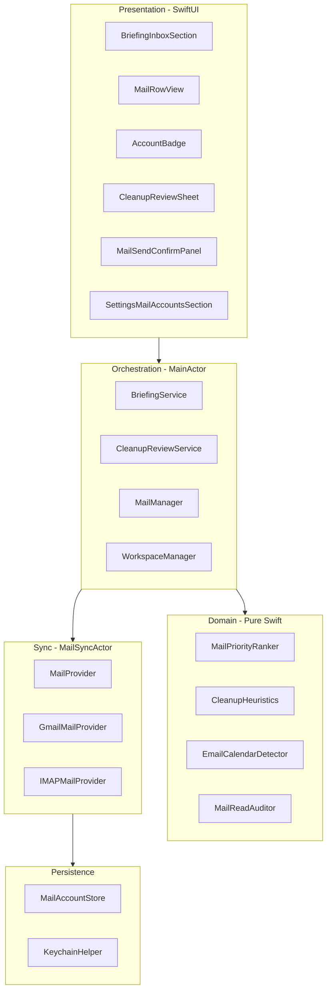
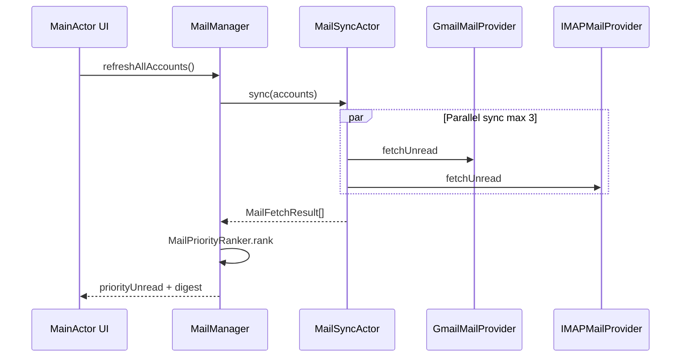

# Zoro Multi-Inbox Mail Architecture

Architecture reference for the hybrid Gmail + IMAP mail system. Intended for review before backend wiring.

## Goals

- Multiple accounts (Gmail OAuth, Namecheap Private Email IMAP, iCloud IMAP) in one Zoro instance
- Unified priority briefing on home (digest + ranked rows)
- Review-then-batch weekly cleanup (archive, not trash)
- Calendar proposals from email via existing Planner confirm flow
- Draft + confirm before send
- Read-only mail over iMessage

## Layer diagram



## Boundary rules

| Layer | May call | Must not call |
|---|---|---|
| Views | `BriefingService`, `MailManager`, `WorkspaceManager` | `GmailService`, IMAP, Keychain directly |
| Services | Domain + `MailSyncActor` / providers | SwiftUI |
| Domain | Foundation only | Network, UI |
| Providers | Keychain, HTTP/IMAP | SwiftUI, agent tools |

## Protocol contracts

### MailProvider

```swift
protocol MailProvider: Sendable {
    var accountId: UUID { get }
    func fetchUnread(limit: Int) async throws -> MailFetchResult
    func search(query: String, limit: Int) async throws -> MailFetchResult
    func readMessage(id: String) async throws -> MailMessageContent
    func archive(id: String) async throws
    func markRead(id: String) async throws
    func createDraft(_ draft: MailDraft) async throws -> String
    func send(draftId: String) async throws
}
```

### MailAccount

```swift
enum MailProviderType: String, Codable { case gmail, imap }

struct MailAccount: Identifiable, Codable, Sendable {
    let id: UUID
    var email: String
    var displayName: String
    var provider: MailProviderType
    var imapHost: String?
    var imapPort: Int?
    var smtpHost: String?
    var isEnabled: Bool
}
```

### BriefingMailItem (UI + briefing)

```swift
struct BriefingMailItem: Identifiable, Equatable, Sendable {
    let id: String
    let accountId: UUID
    let accountLabel: String
    let sender: String
    let subject: String
    let snippet: String
    let receivedAt: Date
    let isUnread: Bool
}
```

### Agent tool surface

- Tool name: `manage_mail` (replaces `manage_gmail`)
- General agent only
- Optional `account_id` / `account_email`; required for writes
- Send path: always creates draft → `pendingMailSend` → `MailSendConfirmPanel`

## Concurrency model



- **`MailSyncActor`**: all network I/O; max 3 concurrent account syncs
- **`MailManager`**: `@MainActor`; published UI state
- OAuth callback: main actor (existing `GmailAuthManager` pattern)
- Provider return types: `Sendable` value types

## Keychain key schema

| Key pattern | Content |
|---|---|
| `mail_gmail_refresh_<accountId>` | Gmail refresh token |
| `mail_gmail_access_<accountId>` | Gmail access token |
| `mail_gmail_expiry_<accountId>` | Token expiry ISO8601 |
| `mail_imap_password_<accountId>` | IMAP app-specific password |
| `gmail_client_id` / `gmail_client_secret` | Shared OAuth app (existing) |

Migration: flat `gmail_*` keys → first `MailAccount` on upgrade.

Persistence: `~/Library/Application Support/Zoro/mail_accounts.json`

## WWDC 2026 / macOS 27 API map

| Apple API | Mail feature | Phase |
|---|---|---|
| `@Generable BriefingMailDigest` | Structured inbox digest line | 2 |
| Dynamic Profiles | On-device summarizer vs PCC deep triage | 2 |
| Content tagging model | personal / newsletter / notification / calendar | 2 |
| Evaluations framework | Prompt regression for digest | 2 |
| SwiftUI lazy `@State` | Briefing inbox section performance | 1 (UI) |
| `.swipeActions()` | Cleanup preview archive | 2 |
| Toolbar `visibilityPriority` | Settings mail toolbar | 2 |
| App Intents stub | Spotlight indexing, future Siri AI | 2 |
| Private Cloud Compute | Optional weekly cleanup summary | 2 |

Skipped v1: Core AI custom models, Spatial Preview, Siri write actions.

Official references:

- [Foundation Models](https://developer.apple.com/documentation/foundationmodels)
- [WWDC26 Platforms State of the Union](https://developer.apple.com/videos/play/wwdc2026/102/)
- [What's new in SwiftUI (WWDC26-269)](https://developer.apple.com/videos/play/wwdc2026/269/)
- [macOS 27 Design Kit](https://developer.apple.com/design/resources/)

## UI component tree

```
BriefingHomeView
├── greetingHeader
├── refresh row
├── Yesterday (briefingSection)
├── BriefingInboxSection          ← new
│   ├── digest line
│   ├── ForEach → MailRowView
│   │   └── AccountBadge
│   └── cleanup CTA → CleanupReviewSheet
├── Today (briefingSection)
└── Suggestions

ChatView
├── plannerConfirmationPanel      (existing)
└── MailSendConfirmPanel          ← new (parallel state)

SettingsView
└── SettingsMailAccountsSection   ← future
```

Shared card styling (from `docs/DESIGN.md`):

- Background: `NSColor.controlBackgroundColor`
- Radius: 12pt
- Border: `Color.secondary.opacity(0.2)`, 1pt
- Max content width: 720pt

## UI/UX Archive Rule ID mapping

Source: [UI/UX Learning Archive spreadsheet](https://docs.google.com/spreadsheets/d/1epO0tyC2_UTWbMDR-KdvOuG_OUoZOaTUdxIKPL6ohik/edit?usp=sharing)

| Rule ID | Mail UI application |
|---|---|
| RULE-001 | Row tap → composer prefill; AI digest adjacent to rows |
| RULE-003 | No custom glass; flat Morning Desk cards |
| RULE-004 | Contrast for unread dots, badges, digest |
| RULE-005 | Native chrome; no title-bar controls (Video 07) |
| RULE-008 | Briefing overview; drill-down in chat |
| RULE-014 | Loading / empty / error states on inbox section |
| RULE-017 | Confirm panels for archive and send |
| RULE-020 | Briefing → chat → confirm → feedback |
| RULE-022 | Cleanup CTA only when candidates exist |
| RULE-031 | Account badges on every row |
| RULE-033 | Apple Mail / Spark patterns via Mobbin refs |
| RULE-038 | Sender > subject > snippet hierarchy |

See `reference/mail-ui-review-checklist.md` for PR review prompts.

## Security (iMessage)

- Whitelist: `manage_mail` read/search/list/status only
- Block remote: send, trash, archive, cleanup, draft create
- Resource caps per account (extend existing Gmail limits)

## Implementation phases

| Phase | Scope |
|---|---|
| **1 (current)** | Architecture docs, UI components, mock briefing inbox |
| **2** | MailAccountStore, MailProvider, Gmail multi-account |
| **3** | IMAP (MailCore2), MailManager, `manage_mail` tool |
| **4** | Cleanup service, calendar detector, Settings, App Intents stub |

## File map

| Path | Role |
|---|---|
| `reference/mail-architecture.md` | This document |
| `reference/mail-ui-review-checklist.md` | PR review checklist |
| `zoro/Models/BriefingMailItem.swift` | Shared briefing row model |
| `zoro/Views/Mail/*.swift` | Mail UI components |
| `zoro/Integrations/Mail/` | Providers, manager, tool (future) |
| `zoro/Services/BriefingService.swift` | Inbox digest + rows |
